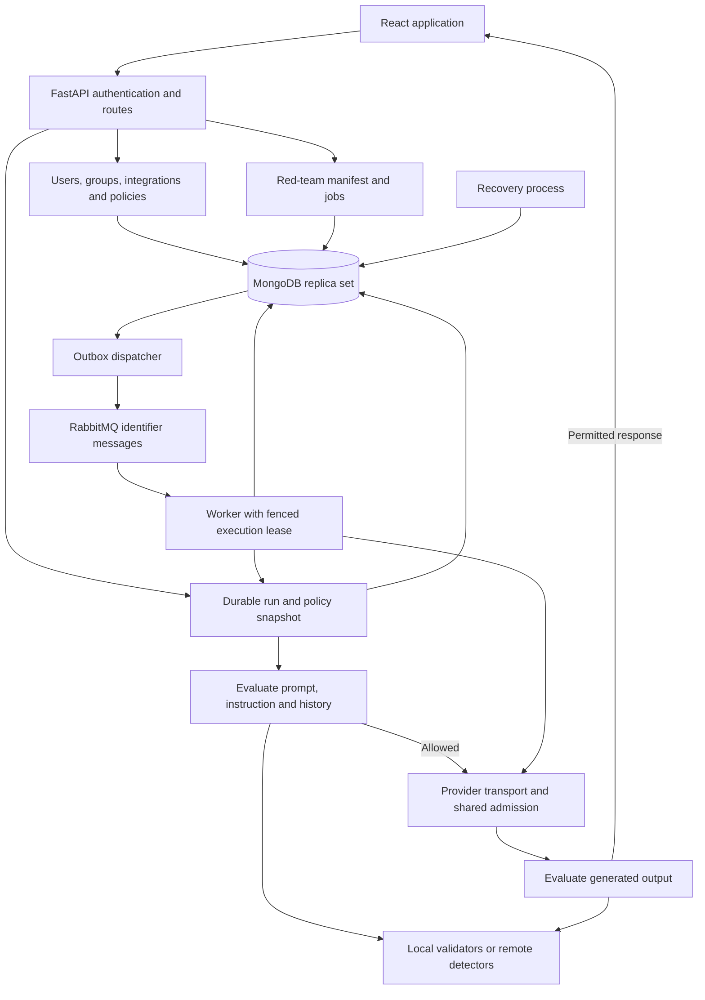

# Deep project review — 11 October 2026

## Assessment

Sentinel AI is a substantial multi-tenant LLM security workspace with administration, protected conversations, incident analysis, and synthetic red-team testing. Its strongest engineering is the durable execution and security-state model. The main remaining work is operational reliability, consistent analytics/readiness, repeatable provisioning, and evaluation of the detectors actually used by the current product.

It has a credible FYP implementation foundation. This review does not establish production readiness or general model-safety accuracy.

This review covers the current working tree, including pre-existing modified and untracked files. Application source was not edited. The previous `PROJECT_ANALYSIS_2026-10-11.md` was used as a review lead, then checked against current code; several of its statements are now outdated.

## Verification performed

| Check | Current result | What it establishes |
| --- | --- | --- |
| `backend/.venv/bin/python -m pytest -q` from backend | 101 passed, 107 skipped, 8 deprecation warnings; 17.86 seconds | Available tests pass; integration behavior is not verified by the skipped tests |
| `npm run lint` from Frontend | Passed | ESLint checks pass |
| `npm run build` from Frontend | Passed; 4.35 seconds | A local production bundle builds |
| `node --test tests/api-contract.test.mjs` | 5 passed | Mocked deployment-contract checks behave as expected |
| Analytics service with synthetic aggregate results | Requested `allowed`; numerator query becomes non-processing; calculated rate 2.0 | Filter population mismatch reproduced without a database |
| Actual red-team hook source evaluated with synthetic React/timer boundaries | Draft → queued, 2 fetches, 0 polling timers | Refreshing an open draft does not start polling |
| Enforcement with a fake detector adapter | Two catalog policies × two input fields = four adapter calls | Calls repeat across distinct policies |
| Remote response parser | `{'results': []}` accepted for a selected Guardrail check | Clean responses do not require an explicit completion summary |

No dedicated `TEST_MONGODB_URL` was configured, so 107 integration tests skipped. No `mongod` executable was found on PATH. Playwright was unavailable through normal root Node module resolution; browser tests were not executed. No live provider calls, remote detector calls, SMTP delivery, RabbitMQ exercise, production data access, vulnerability scan, or new load benchmark was performed. Historical test and performance documents are separate evidence.

## Architecture and ownership

| Layer | Technology and location | Responsibility |
| --- | --- | --- |
| Browser | React 19, Vite 8, Tailwind 4, custom CSS; `Frontend/src` | Auth, navigation, administration, conversations, analytics, red-team views |
| HTTP API | FastAPI; `backend/app/api` | Request validation, current-user dependency, access checks and service entry points |
| Domain logic | `backend/app/services` | Auth lifecycle, administrative mutations, policy resolution, protected execution and reporting |
| Persistence | PyMongo; `backend/app/db`, repositories and direct service queries | Tenant records, versions, audits, encrypted content, incidents and job state |
| Enforcement | Local validator registry and remote Cytex adapters | Input/history/system-instruction checks and output checks |
| LLM providers | Shared bounded HTTP transport | OpenAI, Anthropic, Gemini, Groq, DeepSeek and allowlisted Ollama |
| Background work | Mongo outbox, RabbitMQ/Pika, dispatcher and worker | Synthetic attack delivery, execution leases and outcome recording |
| Deployment | Heroku Procfiles, Netlify configs | API, worker, dispatcher and browser delivery |

This is a modular application, not a collection of independent microservices. Separate worker processes have operational roles but share the application's database and domain code. The repository pattern is partial: many services and the administration router query MongoDB directly.

The protected API is the security boundary. Calls made directly to providers outside this application do not pass through its policies.

## Main workflows

**Identity.** Signup establishes an organization and administrator. Verification, invitations and password reset use expiring hashed challenges. Passwords use PBKDF2-SHA256. JWTs use HS256 and carry user ID, token version and timestamps; the default expiry is 60 minutes. Authentication reloads the account and checks active/verified state, organization status and token version. Tenant identity is derived from the database.

**Administration.** Administrators manage users, groups, integrations and policy assignments. Version checks detect stale updates. Transactions and audit records connect mutations with evidence. A company administration revision serializes competing administrative transactions, including last-admin changes. It is also a potential write contention point under heavy administration load.

**Policies.** Imported DLP and Guardrail catalogs define available checks. Named policy sets select checks and are assigned to active groups; new policies start without assignments. Effective checks are combined across the user's groups within each policy. Historical direct catalog assignments remain supported. Active matching policies apply at their configured input/output stages. BLOCK, ALERT and LOG behavior exists in enforcement; newly created named policy sets default to BLOCK on both stages.

**Protected conversations.** A UUID idempotency key and fingerprint identify an execution. The service creates a durable run, encrypts retained text, freezes policies/groups/instruction and selects owned allowed conversation history. History is limited to 20 exchanges and a 24,000-character content budget; blocked, failed and expired messages are excluded. Current policies recheck the history. Input decisions persist before provider dispatch. The account, organization and integration are checked again; generated output is evaluated before release. Blocks and detector errors withhold generated text.

The current code explicitly restores the validated system instruction before dispatch at `protected_prompt_service.py:429–432`. The earlier review's instruction race is therefore fixed in source. Its database-backed regression exists, but skipped in this run.

**Observability.** Runs, incidents, notifications, model usage, latency and estimated costs are persisted. Workspace and red-team sources are separated. Unknown/partial costs are represented explicitly. Percentiles sample at most 10,000 matching rows; those samples should not be presented as precise whole-population measurements for larger datasets.

**Red Team.** Draft launch freezes configuration and inserts synthetic jobs. The dispatcher publishes identifiers with generation numbers and publisher confirmation. Workers claim fenced Mongo leases, share provider admission with workspace traffic, recheck authority/cancellation and persist prepared outcomes. Recovery distinguishes pre-call retries, persisted-response scoring and uncertain provider execution. Uncertain calls are not automatically replayed. Scoring separates safe, unsafe, inconclusive, errors and benign controls; missing forbidden text alone is inconclusive.

## Strengths

- Server-controlled tenant and security scope, rather than client-supplied organization/groups/instructions.
- Separate Fernet keys for integration credentials and retained content, plus read-time expiry checks.
- Durable input evaluation before external generation and withholding of blocked output.
- Unique idempotency index, explicit fingerprints and deliberate treatment of uncertain external execution.
- Transactional administrative updates, version snapshots and audit evidence.
- Provider/detector requests disable redirects and environment proxies and bound response sizes. Ollama origins are allowlisted.
- Queue messages contain IDs instead of user text; generation numbers and fenced leases guard normal duplicate/stale deliveries.
- Conservative red-team scoring and honest unknown usage/cost states.
- Tests explicitly disable live detector traffic and require isolated test database names.
- Deployment build checks catch a frontend/backend conversation-contract mismatch before Netlify publishing.

## Prioritized findings

### 1. P2: status-filtered analytics use incompatible populations

**Evidence:** `backend/app/services/analytics_service.py:61` overwrites the requested status when building `eligible`. Line 95 similarly overwrites it for `fully_evaluated`. The denominator is calculated from the original filter.

**Impact:** An `allowed` view can count violations from blocked runs, producing a violation rate above 100% or inconsistent totals. A synthetic service invocation returned 2.0 with a denominator of one and a numerator of two; this reproduces query construction and arithmetic, not a real Mongo result.

**Change:** Preserve the original status and intersect additional conditions using `$and`, ideally computing counters from a shared base population. Verify mixed allowed/blocked/processing fixtures for every status filter and zero denominators. Clamping the rate would hide the defect.

### 2. P2: red-team launch does not restart polling for an open draft

**Evidence:** `Frontend/src/hooks/useRedTeamTest.js:20` stops polling for drafts. The effect depends only on `testId` at line 32; `refresh()` at line 33 fetches once without scheduling polling.

**Impact:** Launching the same open draft can leave progress at queued until navigation, visibility change or another refresh. The actual hook source under synthetic boundaries scheduled zero timers after draft → queued.

**Change:** Make polling lifecycle respond to active status transitions or route refresh through the same scheduler. Verify launch, completion, cancellation, hidden tabs, navigation cleanup and stale refresh responses.

### 3. P2: deployed process definitions omit ongoing recovery

**Evidence:** Root and backend Procfiles declare web, worker and dispatcher. `app.queue.recovery` has a continuous loop, but is absent from those definitions. API startup invokes recovery once. Worker delivery acknowledgement occurs in `finally` at `red_team_worker.py:355–361`, including when job processing raises.

**Impact:** A failure leaving a job running can outlive the startup recovery pass. The dispatcher does not claim running jobs; duplicate deliveries do not claim them either. Periodic recovery is essential to the durable-state design.

**Change:** Run and monitor a continuous recovery process or reliable recurring task. Test worker death and Mongo outages with isolated real MongoDB/RabbitMQ. Review acknowledgement against durable state; blindly replaying uncertain provider calls is unsafe.

### 4. P2: fresh-tenant policy setup depends on a separate operator import

**Evidence:** `company_repository.py:49` defaults regular users to required active policies. Signup does not provision catalogs. `policy_sets.catalog()` rejects creation without an active imported catalog. `policy_catalog.import_catalogs()` iterates organizations that exist when the command runs. Example catalog paths point to developer-local Downloads files.

**Impact:** An organization created after import cannot complete regular-user protected onboarding entirely through the application. Administrators are exempt from the required-input-policy rule; an admin-only demo can therefore miss this problem.

**Change:** Provide versioned catalog distribution and per-tenant provisioning, with visible setup status. Keep regular-user required-policy enforcement and clearly label administrator executions without applicable input policies.

### 5. P2: infrastructure readiness does not cover current remote enforcement

**Evidence:** `/api/ready` checks database transactions/indexes and required local semantic models, but not remote catalog enablement or DLP key configuration. It also runs all index creation calls on each readiness probe.

**Impact:** Infrastructure readiness can be green while assigned remote policies fail closed. The workspace context now handles missing required policies and provides per-integration input coverage, so the previous review's blanket missing-policy readiness finding is partly fixed. Overall context readiness still summarizes all integrations rather than only the selected one.

**Change:** Define infrastructure readiness separately from applicable protection readiness. Report configuration, applicability and detector availability distinctly. Move schema/index setup to controlled initialization and keep repeated probes lightweight.

### 6. P2: detector calls multiply across overlapping policies

**Evidence:** `enforcement_service.py` loops policy → rule → field; deduplication in resolution is within a policy. Two policies and two populated input fields produced four adapter calls in isolation. Conversation history adds another field; output adds another stage.

**Impact:** Network work and potential detector cost grow with policy count. Sequential calls share a five-second default stage deadline, so valid policy configurations can fail closed under realistic latency.

**Change:** Where the detector contract permits, evaluate the union of checks once per detector kind/field and map results to all policy versions/actions. Preserve incident attribution. Benchmark remote latency with overlap, conversations and realistic policy counts.

### 7. P2, contract-dependent: clean detector responses lack mandatory completion evidence

**Evidence:** `remote_detection.parse_response({'results': []}, 'guardrail', ['selected-check'])` succeeds. Guardrail summaries are validated if present but optional. Explicit partial/error flags are rejected.

**Impact:** This is correct only if the agreed service contract guarantees omitted passing findings mean all selected checks completed. A service silently omitting unavailable checks could otherwise yield a pass. This review did not test the remote service and does not establish that it behaves that way.

**Change:** Establish versioned clean, violation, unsupported, partial and error schemas; require completion evidence if the contract needs it. Adapter mocks establish parsing behavior, not detector recall.

### 8. P3: configurable invitation expiry is ignored

**Evidence:** `INVITATION_EXPIRE_HOURS` exists, but create, changed-email and resend paths in `user_management_service.py` use `timedelta(hours=72)`.

**Impact:** Operators cannot shorten or extend invitation lifetimes through the documented setting.

**Change:** Use the configuration consistently and verify a non-default value.

## Security and maintainability observations

**Administrative revocation within requests.** The shared administrative transaction rechecks company status but generally does not reload the actor's current role, active state and token version. A request admitted before concurrent demotion can still mutate afterward. This is a narrow concurrency concern; subsequent requests use current-user authentication. Establish and test the intended revocation boundary. The own-group mutation already reloads administrator authority inside its transaction.

**Browser session exposure.** The bearer token is stored in localStorage. JavaScript running in the origin can read it; this review found no specific XSS exploit. Netlify headers include nosniff and referrer policy, but no CSP. Assess session storage and CSP against the deployment threat model. Client logout removes the local token; it should not be described as server-side revocation of all sessions.

**Sensitive text outside storage.** Remote detection receives text, including prompt, instruction, allowed history and generated output. Stored encryption does not keep that text local. Explain these data flows in product/deployment documentation and review detector retention arrangements before handling sensitive real data.

**Contracts and legacy paths.** `prompt_workspace_service.py` remains large alongside the live protected service, while several prompt response schemas describe older fields that the current routes do not bind as response models. Inventory actual references before removal, then consolidate the authoritative execution contract and reduce drift. The large administration router mixes HTTP, validation and persistence logic; extracting domain operations would make authorization and transaction boundaries easier to inspect.

**Frontend state.** Hash routing and explicit local state are sufficient for the current size. Conversation code includes generation fences and retry-key reuse, which are useful safeguards. API calls lack a shared timeout, and async refresh paths vary in cleanup/error handling. Consolidating request cancellation and polling would reduce repeated lifecycle defects. Pages are imported eagerly; the measured JS bundle is 373.06 kB, 108.28 kB gzip. Route lazy loading is a measured optimization opportunity, not evidence that the current application is slow.

**Operations.** MongoDB must support transactions. A liveness-only check can leave a database-unusable web process looking healthy. Encryption key continuity, backups, periodic content expiry, queue recovery and process supervision are essential. The dispatcher heartbeat occurs outside its reconnect try block, so a database failure there can exit the process; supervision should cover that path.

**Test automation.** No `.github` directory was present. Frontend package scripts do not expose the browser suites or API-contract suite as a unified test command, and Playwright is not a declared dev dependency. Local pass results should become reproducible CI gates with a disposable Mongo replica set, RabbitMQ, deterministic providers and browser coverage.

## Evaluation and FYP accuracy

`docs/EVALUATION_RESULTS.md` records historical local synthetic measurements: prompt-injection recall 90% and toxicity recall 60% on its small input dataset. Its 50-concurrent semantic benchmark had 22/50 validation errors and p95 about 5,001 ms; the below-200-ms target was not achieved there. These results were not rerun and do not characterize current remote catalog detectors.

Red-team markers demonstrate narrow synthetic behaviors, not general model safety. The catalog lacks retrieval/tool execution coverage and semantic judge evaluation. A strong thesis contribution is the integrated enforcement/audit/recovery architecture plus transparent controlled experiments. Separate implementation evidence, detector efficacy and performance evidence in the report.

The earlier review's instruction-race and missing-required-policy context findings have been addressed in source. Its statement that the frontend README says enforcement is unavailable is also stale; the current README describes protected execution. `PRODUCT.md` remains Phase 1 oriented, and old schemas/documents still warrant reconciliation. The original DOCX was not re-extracted in this review; report discrepancies are documented in `REPORT_CORRECTIONS.md` rather than independently verified against the DOCX here.

## Recommended sequence

1. Fix filtered analytics and the draft-launch polling lifecycle with targeted regressions.
2. Wire recovery into deployed processes and verify crashes/outages with real isolated infrastructure.
3. Make fresh-tenant catalog provisioning repeatable; test onboarding as a regular user as well as an administrator.
4. Define remote detector completion contracts, improve per-integration readiness, and batch overlapping checks.
5. Run the full integration/browser suite in CI; keep skipped tests visible as missing evidence.
6. Consolidate current schemas/domain boundaries and apply invitation expiry consistently.
7. Evaluate current remote detectors on independently reviewed multilingual and adversarial cases, then benchmark realistic deployment traffic including history and policy overlap.
8. Align product docs and thesis claims with the current code and clearly attributed measurements.

No fixes were applied as part of this analysis. This document is the new review artifact; existing edits and the earlier review were preserved.
