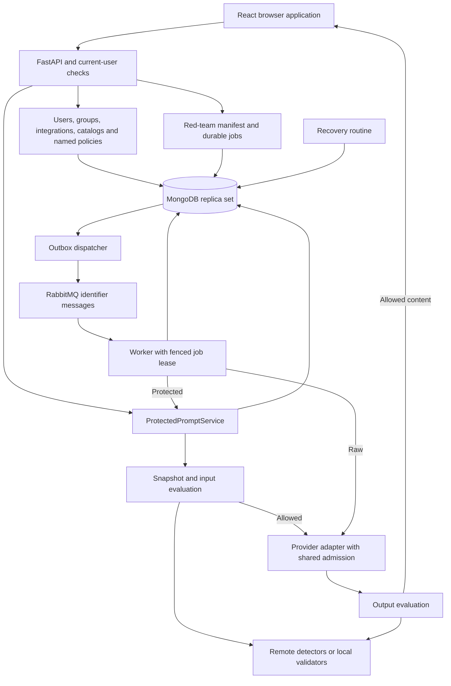

# Project analysis — 11 October 2026

Sentinel AI is a substantial multi-tenant LLM administration and protected execution application. It has credible engineering foundations: server-derived tenant ownership, transactional administration, durable execution records, encrypted credentials/content, input and output enforcement, and a recoverable red-team job model. Its remaining weaknesses are security-context consistency, readiness semantics, detector evaluation evidence, deployment recovery, and documentation accuracy. The current implementation supports an FYP demonstration; production security and distributed reliability remain unverified.

This analysis examines the **current working tree**, including existing modified and untracked files. It does not assume committed HEAD represents the application. No existing application source was changed; this document is the review artifact.

## Scope and evidence

Reviewed the React application, API client and polling, FastAPI routes, authentication, policy administration and resolution, protected execution, providers and pricing, MongoDB indexes and transactions, RabbitMQ publisher/dispatcher/worker/recovery, retention, tests, deployment files, implementation documents, and selected claims extracted from the original DOCX.

Evidence labels used below:

- **Reproduced in isolation:** actual execution or hook code exercised with synthetic state and fake persistence/provider boundaries. This does not establish a complete HTTP/Mongo/browser reproduction.
- **Code-confirmed:** a directly visible implementation behavior or missing connection between modules.
- **Unverified:** an external service, live environment, or performance guarantee was not exercised during this review.

No real model calls, detector calls, SMTP sends, production database access, or dependency vulnerability scan were performed. No test MongoDB was configured, and no `mongod` executable was found in the inspected workspace/home search. Playwright was unavailable through the project's normal Node module resolution, so the browser suite was not rerun. Historical test/evaluation documents are attributed separately from checks run today.

## Product and architecture

The product supports organization administrators configuring users, groups, provider integrations, and policies; employees submitting prompts; and a platform administrator managing organization status. Red Team compares raw provider behavior with protected execution using synthetic scenarios.

| Layer | Current implementation | Main responsibility |
| --- | --- | --- |
| Browser | React 19, Vite 8, Tailwind 4, custom CSS | Authentication, administration, Prompt Studio, analytics, red-team results |
| API | FastAPI, Pydantic, synchronous endpoints | Validation, authentication, authorization, service orchestration |
| Persistence | PyMongo, transaction-capable MongoDB | Tenant records, policy revisions, audits, runs, incidents, job state |
| Detection | Remote Cytex DLP/Guardrail adapters; legacy local validators | Evaluate selected checks before dispatch and before output release |
| Providers | OpenAI, Anthropic, Gemini, Groq, DeepSeek, Ollama adapters | Normalize requests, responses, usage and provider errors |
| Background execution | RabbitMQ/Pika, Mongo outbox, Python worker threads | Synthetic job delivery, leases, retries, result persistence |
| Delivery/session | SMTP; HS256 JWT; PBKDF2-SHA256 passwords | Verification, invitations, reset, current-user resolution |
| Deployment configuration | Heroku Procfiles, Netlify configuration | API/worker/dispatcher process definitions and frontend build |

**The security boundary is the protected application API.** Direct calls from other applications to an LLM provider do not pass through this enforcement path.

The code is organized into routes, services, schemas, repositories, validators, and queue modules. However, the repository pattern is partial: many services and the large administration router query MongoDB directly. This is workable, but the thesis should not claim that repositories encapsulate all persistence.

## Core workflows

**Identity and administration.** Signup creates an organization and its administrator in a transaction. Verification and recovery use expiring hashed challenges. Login issues a JWT containing user ID and token version; current-user resolution reads the account and checks active/verified state, organization status, and token version. Users receive tenant-scoped roles/groups. Administrative writes generally use optimistic versions, transactions, and audit records. The company administration revision serializes conflicting writes, including last-admin changes.

**Current policy product.** Imported DLP and Guardrail libraries provide check definitions. Administrators can now create multiple **named policies**, choose subsets of library checks, and assign each policy to multiple active groups. New named policies have no assignments. Named policies can be edited, disabled, and archived; updates produce snapshots and audits. Earlier direct catalog/group assignments remain supported. Legacy arbitrary `/policies` mutation routes are rejected, but `/policy-sets` creation/editing is implemented. The September 27 review's statement that administrators cannot create policies is therefore incomplete for the current tree.

**Protected execution.** A UUID idempotency key identifies a submission. The service checks enabled integration/model, then creates a durable run with encrypted input/instruction and frozen policy/group context. Required-policy configuration is enforced. Input matches can block before provider dispatch. Account and integration state are rechecked, and a shared integration lease limits concurrency/pacing. Provider output is evaluated before release; blocked output is withheld and is not persisted as response text. Allowed content is encrypted. Terminal outcomes distinguish policy blocks, detector errors, provider errors, unavailable configuration, and interrupted execution.

**Observability.** Workspace runs feed activity, incident review, model usage, spend estimates, and latency percentiles. Incidents carry policy versions and stages. ALERT rules persist recipient notifications. Ordinary workspace and red-team sources are separated for analytics. Estimated pricing is explicitly distinguished from unknown/partial usage.

**Red Team.** Drafts freeze a synthetic manifest at launch and insert durable jobs. The dispatcher publishes only IDs and generation numbers with persistent delivery and publisher confirmation. Workers claim Mongo leases, recheck authority and cancellation, share provider admission with Prompt Studio, and persist prepared responses before final scoring. Recovery separates calls known not to have started, persisted responses that can resume scoring, and ambiguous provider calls that must not be automatically replayed. Exports and paired comparisons use the same scoring definition; PDF output uses browser printing.

## Strengths worth preserving

- Tenant ownership comes from the server's current user record and appears in resource queries. Client-selected tenant/group/system instructions are not trusted for ordinary execution.
- Separate Fernet keys encrypt provider credentials and retained prompt content. Secret reads are masked. Expired content is withheld on reads even before cleanup removes ciphertext.
- Input evaluation is durable before provider dispatch. Output blocks do not release generated text. Detector errors fail closed on the protected path.
- UUID idempotency and a unique tenant/user/key index suppress normal duplicate submissions and reject conflicting payloads. This is not a provider-side exactly-once guarantee.
- Provider and detector transports reject redirects, disable environment proxies, bound response sizes, and avoid forwarding raw remote errors. Ollama origins are allowlisted.
- Queue messages contain identifiers rather than user text. Generation numbers, leases, and fenced writes prevent normal stale deliveries from owning or overwriting current jobs.
- Red-team scoring distinguishes unsafe, safe, inconclusive, technical-error and control outcomes. A missing forbidden marker alone is not treated as proof of safety.
- Database-backed auth limits, request IDs, sanitized Mongo diagnostics, migration dry runs, and explicit retention scripts are useful operational foundations.

## Prioritized findings

### 1. P1 — Ordinary provider dispatch can use an instruction that was never validated

**Reproduced in isolation.** `backend/app/services/protected_prompt_service.py:281` evaluates the original integration instruction. Lines 292–293 fetch a fresh integration immediately before dispatch. Lines 318–319 restore the validated instruction only for red-team mode. Workspace dispatch at lines 332–335 uses the fresh instruction.

Synthetic reproduction exercised the actual execution method with fake persistence/provider boundaries: the validated instruction was `Be helpful`, the live integration instruction was changed to `secret injected after validation`, and an input keyword policy blocked `secret`. The provider received the changed instruction and the run finished `allowed`.

This requires an authorized concurrent integration edit; it is not an arbitrary employee override. Nevertheless, the dispatched content and saved validation evidence disagree. Always preserve the validated system instruction for dispatch while retaining fresh credential/status/model checks, or restart validation when the relevant configuration changes. Add a regression test around this exact interleaving.

### 2. P2 — Filtered analytics can use incompatible numerator and denominator populations

**Query construction reproduced in isolation; full database result not rerun.** `backend/app/services/analytics_service.py:61` constructs `eligible` using `{**query, 'status': {'$ne': 'processing'}}`, overwriting the requested status. Line 95 repeats the problem for `fully_evaluated`. The denominator remains derived from the original query.

A synthetic aggregate stub captured `allowed` for the original population and `{'$ne': 'processing'}` for the violation numerator. With one eligible allowed violating row and another blocked violating row, those constraints produce a rate of `2.0` over a denominator of one. The earlier September review records a Mongo-backed reproduction; today's evidence confirms the query defect still exists.

Intersect constraints using `$and` or derive all counters from a common filtered population. Test every status filter with mixed outcomes, including `processing` and zero denominators. Do not clamp rates to hide the population mismatch.

### 3. P2 — Launching an open red-team draft does not start polling

**Reproduced in isolation using the actual hook source.** `Frontend/src/hooks/useRedTeamTest.js` stops its timer when a draft loads. The effect depends only on `testId`. `refresh()` fetches and updates state but does not schedule another load. `RedTeamPage.launch()` changes that same draft to queued without changing its ID.

The Node hook harness observed `draft → queued`, two fetches, and **zero polling timers**. Progress can remain stale until a visibility event, reopening the route, or another explicit refresh. Polling must respond to entering an active status; verify draft/launch/running/completed transitions and cleanup on navigation/logout.

### 4. P2 — Hosted process configuration omits ongoing red-team recovery

**Code-confirmed deployment gap; failure scenario not exercised on a live broker.** Both Procfiles start web, worker, and dispatcher only. API startup calls recovery once. `python -m app.queue.recovery` provides a continuous recovery loop, but it is not wired into those process definitions. `scripts.reconcile_red_team` is a one-shot command. The deployment guide schedules content expiry but does not schedule red-team reconciliation.

The worker acknowledges messages in `finally`, even when `process_job` raises (`backend/app/workers/red_team_worker.py:355–361`). If an unexpected failure leaves a job `running`, later duplicate deliveries cannot claim it; the dispatcher selects pending/queued/retry states, not running jobs. Recovery is therefore an essential part of this design. Without periodic execution, stale jobs can remain stuck after the web process's initial recovery pass.

Wire a continuous reconciler process or reliable recurring recovery task into deployment, cover recovery health, and test worker death/database outage with a live isolated broker. Review acknowledgement behavior against the intended durable-state contract.

### 5. P2 — Fresh organizations cannot initialize protected policies through the UI alone

**Code-confirmed.** `CompanyRepository.create` sets `require_active_policy=True`; signup creates no catalog. Named policy creation requires an existing active imported catalog (`policy_sets.catalog`). `import_catalogs` provisions only organizations that already exist when the command runs. The documented source files are developer-local Downloads paths and are not bundled with this repository.

Consequently a new organization can configure groups/integrations but cannot complete its default protected setup until an operator imports catalogs again. This is a safe failure, but incomplete onboarding. Provide versioned catalog distribution and tenant provisioning, or an explicit operator workflow with visible onboarding status. Keep required-policy enforcement.

### 6. P2 — Readiness signals do not consistently describe usable enforcement

**Code-confirmed.** `/api/ready` checks MongoDB transactions/indexes and active local injection/toxicity models, but not managed remote detector configuration (`backend/app/api/routes/health.py:25`). It can be green while assigned catalog prompts fail closed because remote detection is disabled or the DLP key is missing.

`ProtectedPromptService.context` also reports `enforcement_ready=True` when there are no applicable policies: the missing-validator list is empty, without considering the organization's required-policy setting. The UI then displays “Protected prompt workflow,” while submission ends with `policy_required`. The policy capability endpoint is stronger in some respects but includes unassigned active catalogs, so it answers a different question again.

Define infrastructure readiness separately from per-user/per-integration protection readiness. Include policy applicability and required-policy settings in the latter, distinguish configuration from remote reachability, and avoid re-running all index creation on every health probe.

### 7. P2 — Overlapping named policies repeat remote checks within a shared stage deadline

**Reproduced at adapter boundary.** `evaluate_stage` iterates policy → rule → field (`backend/app/services/enforcement_service.py:47–59`). `resolve_policies` deduplicates selected IDs across groups within one policy, not across distinct named policies.

Two named Guardrail policies selecting the same check caused **four detector adapter calls during input evaluation** when both user prompt and system instruction were nonempty. Output evaluation would add another call per policy. A DLP plus Guardrail policy can likewise require four sequential input calls; additional overlapping policies multiply this work. All input calls share the default five-second stage budget.

The current policy documentation says matching checks are combined; it should clarify the implementation boundary. Batch the union by detector kind and field where the contract permits, then map findings back to every policy/version for incidents and actions. Benchmark the current remote path with realistic selected checks and policy counts. Network latency and detector billing were not measured here.

### 8. P2 — A clean detector result does not require explicit completion evidence

**Acceptance behavior reproduced; service-contract correctness unverified.** `parse_response({'results': []}, 'guardrail', ['same'])` returns no findings. Guardrail summary counts are checked when supplied, but are optional. DLP also accepts empty findings without per-selected-check completion evidence.

If the agreed service contract guarantees empty arrays mean all selected checks completed and passed, this can be valid. If the service can omit unavailable checks or return partial results without the optional flags, the adapter could label incomplete evaluation as a pass. The repository itself calls the contract provisional. Obtain an explicit contract for clean, violation, unsupported check, timeout, partial failure and error responses, and enforce required completion fields where necessary. Adapter mock tests do not measure detector recall.

### 9. P2 — Thesis and setup claims disagree with the implemented application

**Direct comparison with extracted DOCX text.** The report claims bcrypt, a 24-hour JWT, tenant identity in JWT claims, middleware with a 60-second policy cache, prompt-bearing Rabbit messages, subprocess workers, and a achieved 200 ms target at 50 concurrent users. Current code uses PBKDF2-SHA256, a configurable 60-minute default, database-derived tenant identity, service-based enforcement, identifier messages, and threads.

The original report also claims 90% accuracy and a GPT-3.5-Turbo red-team score. Those measurements were not reproduced here. `docs/EVALUATION_RESULTS.md` records narrower local measurements with semantic misses and timeout failures at concurrency. Those historical local model measurements do not characterize today's remote catalog path.

`Frontend/README.md` still says policies are not enforced; `PRODUCT.md` remains Phase 1 oriented; `REPORT_CORRECTIONS.md` predates named policies and deployment configuration. Update the thesis, diagrams, setup and experiment tables together. Distinguish proposed targets, historical measurements, implementation, and verified behavior.

### 10. P3 — Invitation expiry configuration is ignored in administration paths

**Code-confirmed.** `INVITATION_EXPIRE_HOURS` is configurable, but `user_management_service.py:110`, `:155`, and `:224` hardcode 72 hours. Use the configuration consistently for create, changed-email invitation and resend, and verify a nondefault value.

## Further engineering observations

**Administrative authority can become stale within a request.** `require_admin` generally checks the supplied user before the transaction. The shared transaction helper rechecks the organization but does not re-read the actor's active state, role and token version. A concurrent demotion/deactivation can therefore race with an already-admitted mutation. Subsequent requests still go through current-user checks. Define the in-flight revocation guarantee and add an interleaving test before asserting immediate administrative revocation.

**Policy snapshots can become expensive.** Named policy documents copy the full catalog entries, policy versions copy the complete document, and each prompt run embeds applicable policy snapshots. Small selected subsets still carry the full library. Many named policies can substantially amplify storage, BSON transfer and transaction work. The 50-policy/500-rule guard does not bound serialized catalog bytes. Prefer immutable catalog revisions referenced by ID/hash plus minimal execution snapshots; measure document sizes before changing audit semantics.

**System instruction retention is broader than prompt ciphertext retention.** Red-team `config_snapshot.system_instruction` is plaintext historical configuration, and content cleanup targets prompt-run ciphertext and job response ciphertext. Define instruction retention explicitly. This is separate from provider credential encryption and does not demonstrate key disclosure.

**Synchronous execution limits deployment flexibility.** Provider waits and sequential validation occupy request-processing capacity. The deployment guide already recognizes host request-duration limits. A lower provider timeout is useful headroom, but it is not an end-to-end deadline and native semantic inference cannot be forcibly cancelled by the current timing check. Longer runs need durable asynchronous execution with status polling. Shared single-flight/six-per-minute admission also means red-team tests can delay workspace traffic.

**Frontend structure is understandable but uneven.** Hash routing, a central page registry, shared API errors, and permission helpers make navigation straightforward. Modal focus trapping/restoration and loading surfaces are useful foundations. Large compressed JSX components mix requests, state transitions, forms and tables, making concurrency bugs harder to see. The policy page now paginates all groups and named policies, which corrects a limitation of older reviews; Red Team's user selector still requests only the first 100 active users.

**Session and retry UX needs a defined policy.** JWTs are in local storage and therefore readable by JavaScript; this is a design tradeoff requiring an XSS/session review, not an exploit found here. The API client does not expose `Retry-After` as a structured error property. Invalid/non-JSON gateway responses and request cancellation deserve explicit UX tests. No comprehensive browser/accessibility audit was performed during this analysis.

**Maintainability and operations.** The administration router contains substantial domain logic alongside services, and older `PromptWorkspaceService`/mock dashboard assets remain. Consolidate active execution paths and separate administration domains gradually. No CI workflow was found. Pinned direct Python packages and a frontend lockfile help reproducibility, but installed-environment consistency does not certify a fresh deployment or absence of vulnerabilities. Key rotation, backup restoration, monitoring and live-provider acceptance need their own evidence.

## Verification performed today

| Check | Result | Boundary |
| --- | --- | --- |
| Backend `DATABASE_MODE=mongodb .venv/bin/python -m pytest -q tests` | **83 passed, 86 skipped**, 8 warnings, 15.56 s | Integration tests skipped without `TEST_MONGODB_URL`; explicit database-mode override used |
| Frontend `npm run lint` | Passed | Static lint only |
| Frontend `npm run build` | Passed | 71 modules; JS 361.15 kB / 105.10 kB gzip; CSS 103.76 kB / 19.76 kB gzip |
| Backend `.venv/bin/python -m pip check` | Passed | Installed dependencies consistent; not a security audit |
| Existing `git diff --check` | Passed | Working-tree whitespace check |
| Instruction race | Reproduced with actual service method | Synthetic persistence/provider boundaries; no Mongo/HTTP |
| Analytics status mismatch | Captured incompatible query constraints | Synthetic aggregate responses; no Mongo execution |
| Draft launch polling | Queued state, 2 requests, 0 timers | Actual hook source in isolated Node harness; no browser |
| Overlapping policy checks | 4 input adapter calls for 2 identical-check policies | Fake detector adapter; no remote traffic |
| Empty remote result | Accepted without summary | Actual response parser; service semantics unverified |
| DOCX consistency | Several contradictions confirmed | Selected relevant paragraphs extracted; external references not verified |

Build emitted a plugin-time warning; it completed successfully. Python warnings came from upstream deprecations. The browser policy regression, live RabbitMQ transport, multi-worker crash/reconnect behavior, real SMTP delivery, live providers, current detector accuracy and production load were not verified today. Historical September full-suite counts should not replace today's **83/86** result.

## Changes since the September 27 review

| Earlier observation | Current assessment |
| --- | --- |
| No configurable custom policy product | Named catalog-backed policy sets now exist, with separate group assignment and status/version operations |
| One shared selection per policy type | Multiple named policies and legacy group-specific selections are supported |
| Protected red-team pricing uses live integration prices | Corrected: execution now uses frozen `price_snapshot`; allowed run serialization and worker persistence retain `pricing_snapshot` |
| No deployment manifests | Heroku and Netlify files now exist; recovery wiring still needs attention |
| Policy UI may fetch only 100 groups | Current policy page retrieves all pages; Red Team user selector remains capped |
| Instruction race, analytics filter issue, polling launch issue | Still present in the inspected code; isolated reproductions performed today |
| Invitation duration hardcoded, catalog onboarding dependency, stale report | Still present |

## Completion order and acceptance evidence

1. **Correctness:** fix instruction consistency, analytics filter intersection, and polling transitions. Add focused regression cases that exercise the failing interleavings/populations, plus a draft-to-completion browser flow.
2. **Operational completion:** run the reconciler continuously or schedule it reliably; make catalog provisioning repeatable; expose truthful per-user/per-integration protection readiness. Test a clean database onboarding flow and expired job leases.
3. **Detector integration:** finalize response completion semantics, avoid repeated overlapping checks where possible, and evaluate the remote catalog path against independently reviewed positive/negative examples. Report per-category precision/recall, timeout rates, controls and coverage.
4. **Distributed verification:** use an isolated transaction-capable MongoDB and RabbitMQ environment for publisher confirmation, broker restart, duplicate deliveries, worker death before/after dispatch, saved-response recovery, cancellation, and concurrent workspace/test pacing. Record possible-cost outcomes rather than replaying ambiguous calls.
5. **Academic and release evidence:** reconcile thesis/docs, automate lint/build/unit/integration checks, and publish measured results with dataset/model/service versions and clear limits. If production is in scope, add backup restoration, secret rotation, monitoring and deployment acceptance evidence.

The defensible current claim is a locally implemented multi-tenant administration, protected prompt execution, and bounded synthetic red-team platform. Broader detector accuracy, production readiness, exactly-once provider execution and high-concurrency latency guarantees require additional evidence.
