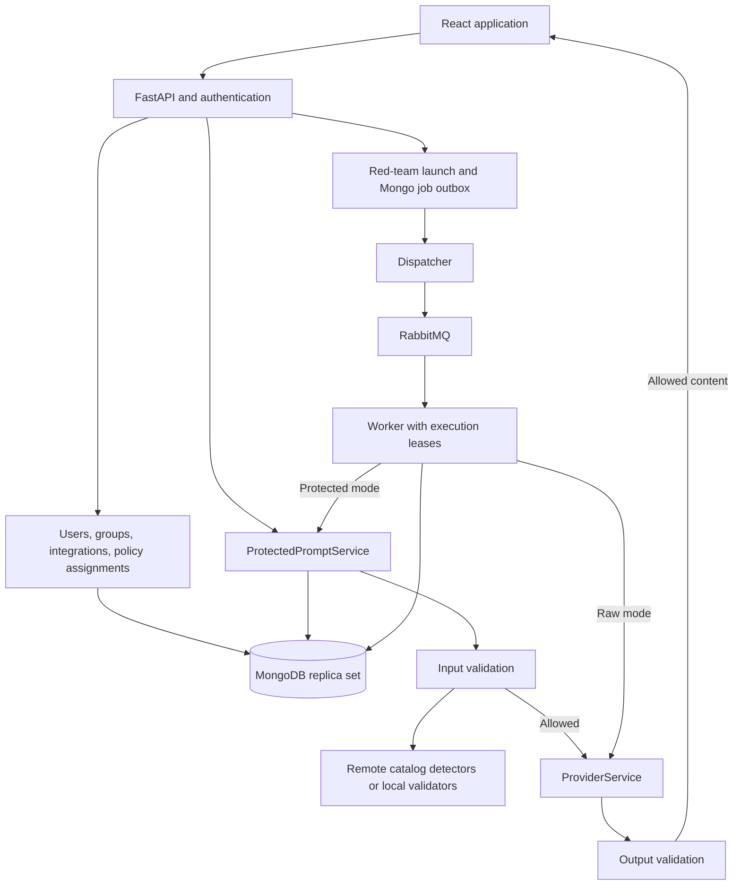

Project review — 27 September 2026

The current working tree is a substantial local LLM-security application with working administration, protected prompt execution, observability, and a queued synthetic red-team implementation. Its strongest parts are tenant-scoped access, durable execution records, explicit failure outcomes, and regression coverage. It is not yet demonstrated as a production-ready security service. Several correctness problems remain despite a passing test suite, and the original FYP report describes materially different behavior.

This review covers the application architecture, principal backend and frontend workflows, configuration, persistence, queue/recovery design, tests, operational scripts, dependencies, documentation, and implementation claims in the DOCX report. Findings below distinguish reproduced defects from code-review observations and unverified external behavior. Existing source changes were preserved; this report is the only source-tree addition made by the review. This is not an exhaustive penetration test, dependency vulnerability audit, live-provider certification, or visual/accessibility audit of every screen.

**Current product and architecture.** The application is branded Sentinel AI, while some database and browser-storage names still use Centurion. React 19 and Vite 8 provide a browser SPA with hash-based navigation. FastAPI serves synchronous domain endpoints using PyMongo. MongoDB must support transactions. RabbitMQ, a dispatcher, a worker, and a reconciler support red-team execution. SMTP is required for ordinary verification and invitations. Integration credentials and retained prompt content use separate Fernet keys.



The current policy product has changed since Phase 2. The UI now exposes two imported managed catalogs, DLP and Guardrail. Administrators select catalog entries and assign groups. Custom policy create/edit/status HTTP routes reject mutations. The older keyword, regex, PII, injection, and toxicity validators still exist internally, with tests and historical records, but are no longer configurable through the ordinary policy editor. Imported catalog entries are metadata; they do not install or execute the listed detector plugins locally. The managed path delegates detection to the two configured Cytex endpoints.

**Module assessment.**

| Area | Implemented behavior | Important boundary |
|---|---|---|
| Authentication | Signup, email verification, login, reset, invitation acceptance, JWT token versions, database-backed limits | SMTP delivery was mocked in this review; tokens are stored in browser local storage |
| Tenant administration | Organization-derived scope, users, groups, role checks, optimistic versions, last-admin protection, audit records | Shared admin transactions recheck company status but do not re-read the acting administrator's current authority |
| Integrations | Six provider adapters, model discovery, encrypted credentials, allowlisted Ollama origins, configured model prices | Adapter tests do not establish compatibility with every live model |
| Policies | Catalog import, immutable revisions, shared entry selections, independent group assignments | Each policy type has one selection shared by all assigned groups; new organizations need a manual import |
| Prompt Studio | Server-owned memberships/instructions, input/output checks, idempotency, run detail/history | Protects only traffic through this application; no interception of other applications' provider calls |
| Observability | Run outcomes, violations, reviews, recipient notifications, spend/latency/model summaries | Filtered rate calculation has a reproduced bug; costs are estimates |
| Red Team | Draft/edit/clone/launch/cancel, raw/protected modes, synthetic cases, scoring, exports, browser print | Live broker/reconnect/multiple-worker behavior remains outside this review's verification |
| Operations | Indexes, liveness/readiness, migration scripts, content cleanup, interrupted-run reconciliation | No repository deployment manifest or CI workflow was found in the reviewed file inventory |

The key collections are companies, users, groups, integrations, policies, policy_versions, audit_events, auth_rate_limits, prompt_runs, violations, notifications, red_team_tests, red_team_jobs, integration_execution_locks, and worker_heartbeats. Compound indexes support tenant access, recent records, uniqueness, idempotency, and leases. TTL indexes clean rate-limit and worker-heartbeat records; content ciphertext requires the explicit expiration job, while read endpoints enforce content expiry independently.

**Execution and security strengths.** An ordinary prompt first creates a durable record with its policy snapshot and encrypted content. Input blocks prevent provider dispatch. Output blocks withhold generated text and avoid persisting that text. The same idempotency key cannot deliberately generate a second provider call, and a conflicting payload is rejected. Uncertain calls are not automatically replayed. Violations and alert recipients are persisted with tenant ownership. Errors retain request IDs without exposing raw exception text.

Authentication derives tenant membership from the database, rather than trusting a client-selected organization. Current-user resolution checks active and verified status, company status, and token version. Credential reads are masked, provider redirects are rejected, and the main provider transport limits response size. The red-team queue carries identifiers rather than prompt content. Fenced writes and durable job states are a sensible design for at-least-once delivery. Scoring separates unsafe, safe, inconclusive, technical-error, and benign-control outcomes rather than treating every missing forbidden string as a success.

**Verification performed for this review.**

| Check | Observed result |
|---|---|
| Frontend ESLint | Passed |
| Frontend production build | Passed; JS approximately 324.82 kB, 94.17 kB gzip; CSS approximately 60.11 kB, 12.15 kB gzip |
| Default backend pytest command | Failed collection because effective DATABASE_MODE was not mongodb |
| Backend pytest with DATABASE_MODE=mongodb and no test Mongo URL | 50 passed, 75 skipped |
| Backend pytest using local replica set and disposable test databases | 125 passed, 8 upstream deprecation warnings, 71.13 seconds |
| Policy-page browser regression | Passed; API calls mocked; includes 235 groups, bulk/single-group edits, preservation of hidden assignments, failure recovery, mobile layout, regular-user restrictions |
| Installed Python dependency consistency | pip check passed |
| Git whitespace check | Passed |
| Additional system-instruction race and analytics reproductions | Both defects reproduced using synthetic fixtures and a fake provider |
| Red-team polling logic reproduction | Draft-to-queued refresh made two requests but scheduled zero polling timers |

The full backend command was run from backend:

```bash
DATABASE_MODE=mongodb \
TEST_MONGODB_URL='mongodb://127.0.0.1:37017/?replicaSet=sentinelLocal' \
TEST_MONGODB_DB_NAME=test_project_review \
.venv/bin/python -m pytest -q tests
```

The fixture appends a random suffix to the test database name and drops that fixture-created database afterward. The additional reproductions also used a fresh disposable database and removed it. No production/application data or real provider calls were needed. The policy browser test used a temporary Vite process on port 5187. An additional ad-hoc browser harness for the polling hook failed to load its test UI and timed out; the polling finding was instead reproduced with an isolated Node harness of the actual hook source. It is not claimed as an end-to-end browser reproduction.

**Prioritized findings.** P1 means fix before claiming the affected security guarantee; P2 means a material correctness or workflow problem; P3 means a smaller inconsistency.

1. **P1 — Provider dispatch can use an unvalidated system instruction. Reproduced.** In `backend/app/services/protected_prompt_service.py:292`, execution re-fetches the integration after input validation. Only red-team mode restores the frozen instruction at line 319. Ordinary workspace dispatch passes the freshly fetched instruction to the provider at lines 332–335, although input validation and the saved ciphertext describe the earlier instruction. Reproduction: validate “Be helpful,” change the integration instruction to “secret injected after validation” immediately after input-stage persistence, then dispatch under an input policy blocking “secret.” The provider received the changed instruction; the run was `allowed`; its saved instruction remained “Be helpful.” This requires a concurrent authorized integration edit, not an arbitrary employee override. Preserve the validated instruction for dispatch, or restart validation when its version changes. Keep the live status/credential checks.

2. **P2 — Status-filtered analytics can return rates above 100%. Reproduced.** `backend/app/services/analytics_service.py:61` builds the numerator query with `{**query, 'status': {'$ne': 'processing'}}`, replacing the requested status filter. The denominator still uses the original status. With one blocked violating run and one allowed LOG-match run, requesting `status=allowed` returned `total_submissions=1`, `violation_rate_denominator=1`, and `violation_rate=2.0`. The fully-evaluated count at line 95 has the same filter replacement. Preserve both constraints using an intersection, and test every supported status filter against mixed outcomes.

3. **P2 — Launching an already-open red-team draft does not restart polling. Reproduced at hook level.** `Frontend/src/hooks/useRedTeamTest.js:20` deliberately stops scheduling after loading a draft. Launch updates state and calls `refresh()`, but that function at line 33 only fetches and sets state. The effect depends on testId, which stays unchanged. The isolated hook reproduction moved from draft to queued with zero scheduled timers. The displayed progress can therefore remain queued until a visibility change, route reopen, or another refresh. Make polling react to the transition into an active state and cover draft → launch → running → completed in a browser test.

4. **P2 — New-organization onboarding cannot provision the current policy product. Code and documentation confirm the gap.** Signup and `CompanyRepository.create` create the organization with `require_active_policy=True` but no catalog policies. Public policy creation is disabled. `import_catalogs` provisions only organizations already present at import time. The documented catalog sources are files under a developer's Downloads directory, absent from this repository. Consequently a fresh organization cannot complete protected prompt setup through the UI alone. Provide a reproducible, versioned catalog provisioning process and an explicit organization-initialization step; preserve the intended no-policy failure behavior.

5. **P2 — General readiness omits the managed detectors now used by the product. Code-confirmed.** `backend/app/api/routes/health.py:25` checks only local injection and toxicity model readiness. It does not check whether applicable managed catalog configuration is usable, such as enabled remote detection and the required DLP key. MongoDB can be ready while assigned catalog prompts fail closed. The policy capabilities endpoint contains stronger configuration checks, so the two signals disagree. Separate infrastructure readiness from enforcement readiness explicitly or align the checks. Do not describe configuration readiness as a guarantee that a remote service is reachable. Also move repeated index creation out of every readiness request.

6. **P2 — Price snapshot semantics differ between raw and protected red-team execution. Code-confirmed.** Launch saves `config_snapshot.price_snapshot`; raw workers estimate from it. Protected execution estimates from the live integration's model_prices at `protected_prompt_service.py:349`, ignoring that frozen price snapshot. Editing prices between launch and execution can produce different accounting bases for the paired modes. Ordinary runs also lack an explicit persisted price-rate snapshot. Decide the pricing reference time and consistently store and use it.

7. **P2 — The report and older setup documentation are materially stale. Direct comparison.** The DOCX says bcrypt, 24-hour JWTs, enforcement middleware with a 60-second cache, prompt-bearing queue messages, subprocess workers, and measured performance/results not established by this review. Actual code uses PBKDF2-SHA256, a configurable 60-minute default, a service-based protected path, identifier-only queue messages, and threads. `Frontend/README.md` still says policies are not enforced. `PRODUCT.md` still describes Phase 1. `docs/REPORT_CORRECTIONS.md` is useful but predates the managed-catalog product change. Update the thesis, diagrams, setup, and capability claims together before presentation/submission.

8. **P3 — Invitation expiry configuration is ignored in ordinary administration. Code-confirmed.** `INVITATION_EXPIRE_HOURS` exists in config, but create, changed-email invitation, and resend paths in `user_management_service.py:110`, `:155`, and `:224` hardcode 72 hours. Use the configured value consistently.

**Other engineering observations.** Administrative operations check the supplied actor's role before entering a transaction; the shared transaction helper checks the company's status but not the actor's current role/active status/token version. An already-authenticated request can race with administrator deactivation or demotion. This is an in-flight authority race, not evidence that subsequent requests bypass current-user authentication. Add a concurrent-revocation test and make the desired guarantee explicit.

Provider system instructions are also copied as plaintext into red-team config snapshots. Content cleanup handles prompt-run ciphertext and job response ciphertext, not those test snapshots. Existing integration configuration is itself stored as configuration, so this is not equivalent to a newly exposed provider key; nevertheless historical instruction retention should be explicitly defined rather than covered by a blanket “all content is encrypted and expires” claim.

The managed detector response contract remains provisional. Empty findings arrays are accepted without mandatory per-selected-check completion evidence. The repository itself requests confirmation of clean, violation, partial-failure, and error semantics. Mock contract tests establish adapter behavior, not detector recall or actual completion guarantees. The reported September 27 external smoke test is historical documentation, not a call repeated during this review.

The validator stage timeout is not a hard cancellation boundary for native semantic inference. Local evaluation documentation already records missed latency targets and detector misses. Those old local-model measurements also do not measure the current remote managed-catalog pipeline. Red-team exact-marker scores are intentionally narrow and should not be presented as comprehensive resistance to adversarial prompts.

Frontend maintainability is uneven: several large components compress substantial state and markup onto long lines, request cancellation is inconsistent, and some selection lists fetch only the first 100 records. Catalog usage is grouped by provider/model but repeated on integration-specific rows, which can imply per-integration counts. The API client does not expose Retry-After as a structured property. Browser local-storage JWTs are readable by JavaScript; this warrants an explicit session/XSS design review, but no XSS exploit was demonstrated here. Unused mock dashboard assets and the old internal PromptWorkspaceService remain and can confuse future maintenance.

The repository has a frontend lockfile and pinned direct backend requirements. pip check confirms this installed environment is internally consistent; it does not prove a fresh install resolves identically or establish absence of vulnerabilities. Numerous existing tracked modifications and untracked implementation files mean reviewing only committed HEAD would omit much of the actual application.

**Recommended completion order.** First fix the instruction race, analytics filter intersection, and polling transition, adding regression tests that reproduce each failure. Next make new-tenant catalog provisioning reproducible, align enforcement readiness, settle price/retention semantics, and correct invitation configuration. Then validate RabbitMQ confirmation/reconnect/crash recovery and shared pacing with multiple workers, using isolated synthetic workloads. Confirm remote detector contracts and obtain representative evaluation evidence for the current detector path. Finally reconcile the report and setup guides, automate the existing checks, and define deployment/backup/key-rotation operations if production becomes part of the scope.

For an FYP demonstration, the application has a credible implementation foundation and meaningful passing tests. Its defensible claim is a locally implemented multi-tenant administration and protected execution platform with bounded synthetic evaluation, subject to the defects and verification limits above. Production security, broad detection accuracy, live distributed-worker reliability, and the original report's performance claims require additional evidence.
